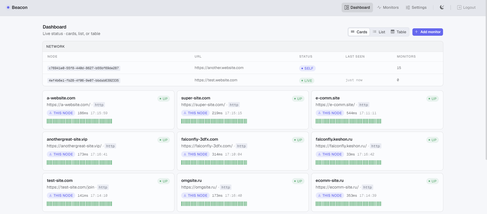

# Beacon

**Lightweight self-hosted uptime monitor for HTTP and TCP endpoints**

Beacon is a lightweight uptime monitoring tool for HTTP and TCP services.

It runs as a single Go binary, periodically checks your targets, sends alerts on failures and recovery, and provides a simple web dashboard with recent uptime history.

Checks HTTP URLs and TCP `host:port` targets without installing agents on the
monitored services. Templates and static assets ship with the server.



## Why Beacon

| | |
|---|---|
| **Small footprint** | Single binary, minimal setup, lightweight runtime requirements |
| **Simple web UI** | Dashboard, monitor management, live status updates, dark/light theme |
| **Flexible notifications** | Telegram, Discord, email, and webhooks with per-monitor channel overrides |
| **Multi-instance sync (optional)** | Peer visibility and dead-node failover (see limitations below) |

## When Beacon makes sense

Beacon is designed for:

- small VPS setups
- self-hosted services
- side projects
- homelabs
- lightweight production monitoring
- simple uptime alerting without a full observability stack

If you need metrics storage, distributed tracing, or deep infrastructure analytics, use a full observability platform instead.

## Features

- HTTP and TCP checks with interval, timeout, and retry threshold
- HTTP checks: optional Basic Auth and response keyword matching
- Down and recovery notifications via Telegram, Discord, email, and generic webhooks
- Global notification settings with per-monitor per-channel overrides (Global / Off / Custom)
- Real-time dashboard updates and uptime history
- Basic authentication for web UI and API
- REST API for automation and integration

## Quick start

Use Go 1.25+ as declared by [go.mod](go.mod):

```bash
git clone https://github.com/keshon/beacon.git
cd beacon
go run ./cmd/beacon
```

Open `http://localhost:8080`. A fresh install without bootstrap credentials uses
`admin` / `admin`; keep the listener private and change credentials before
exposing it. Run from the repository root so templates/static assets are found.

Configuration and monitor state live in `data/`. A `config.json` only seeds a
store without saved configuration. See [Running](docs/running.md) for setup,
verification, notification settings and backups.

## Peer mode

Optional synchronization adds peer visibility and adoption of previously cached
monitors after a peer outage. It has no quorum or distributed alert deduplication;
network partitions can duplicate checks and alerts. Read [Sync](docs/sync.md)
before relying on it for recovery.

## Documentation

| Guide | Contents |
|---|---|
| [Running](docs/running.md) | Setup, configuration, notifications, deployment and state recovery |
| [HTTP API](docs/api.md) | Authentication, routes and automation |
| [Peer synchronization](docs/sync.md) | Topology, credentials, adoption and partition limits |
| [Architecture](ARCHITECTURE.md) | Components, startup, persistence and check/alert flows |
| [Conventions](docs/conventions.md) | Development, package ownership and verification |

## License

MIT License

Copyright (c) 2026 Innokentiy Sokolov
